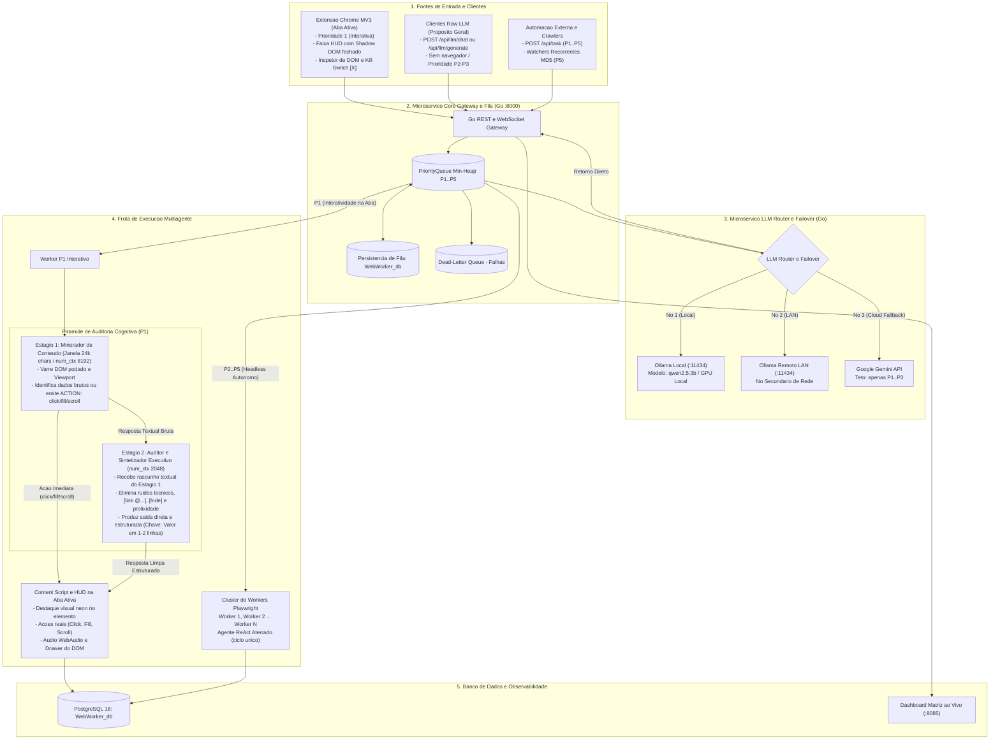
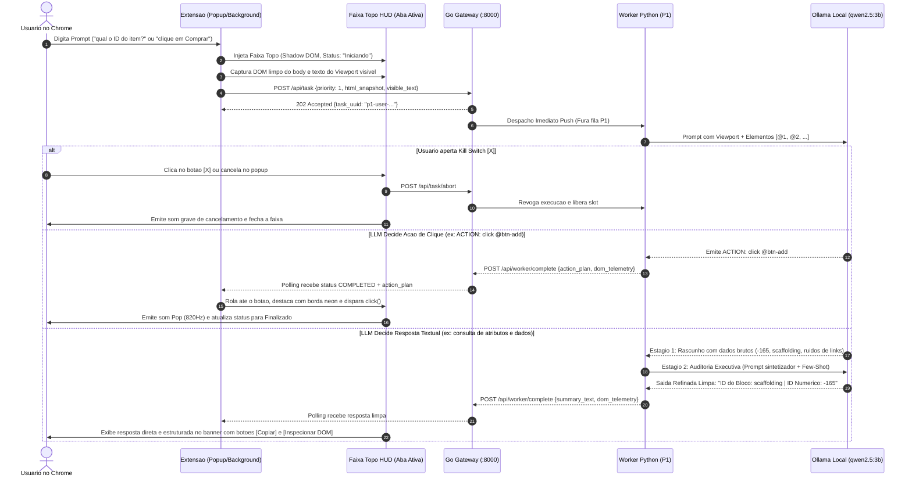
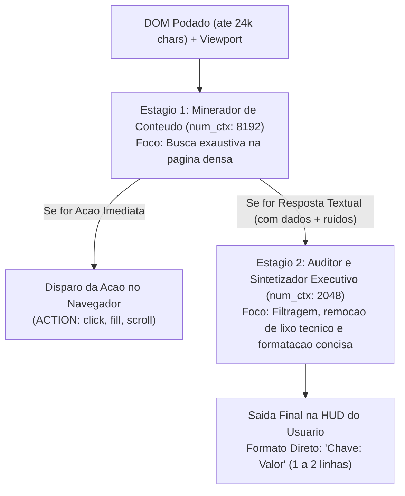
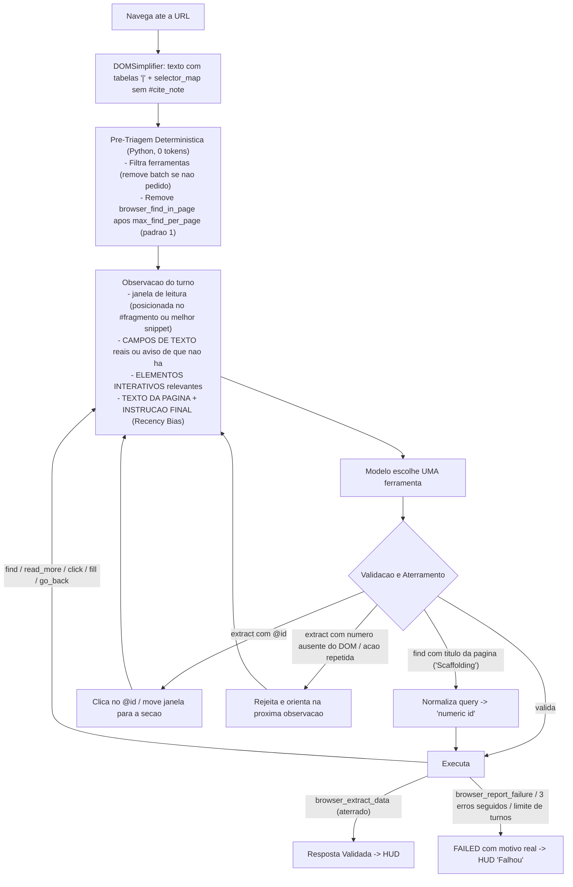

# Catalogo Completo de Habilidades e Arquitetura do WebWorker AI

> **Guia Unificado de Habilidades, Ferramentas e Arquitetura do Agente Web**  
> **Plataforma:** WebWorker AI Platform (Versao 1.2)  
> **Status:** Producao / Consolidado em Arquivo Unico

---

## Indice Geral

1. [Organograma Arquitetural da Plataforma](#1-organograma-arquitetural-da-plataforma)
2. [Diagrama de Sequencia: Ciclo Interativo P1 na Aba Viva](#2-diagrama-de-sequencia-ciclo-interativo-p1-na-aba-viva)
3. [Interface de Linha de Comando (CLI & Start Platform)](#3-interface-de-linha-de-comando-cli--start-platform)
4. [Habilidade: browser_fill (Preenchimento de Campos e Busca)](#4-habilidade-browser_fill)
5. [Habilidade: browser_click (Clique em Botoes, Links e Abas)](#5-habilidade-browser_click)
6. [Habilidade: browser_fill_form (Formularios Complexos em Lote)](#6-habilidade-browser_fill_form)
7. [Habilidade: browser_navigate e browser_go_back (Navegacao e Historico)](#7-habilidade-browser_navigate-e-browser_go_back)
8. [Habilidade: browser_scroll (Rolagem Suave de Pagina)](#8-habilidade-browser_scroll)
9. [Habilidade: browser_extract_data (Extracao Estruturada de Dados)](#9-habilidade-browser_extract_data)
10. [Habilidade: browser_discover_batch_links (Varredura de Catalogos em Lote)](#10-habilidade-browser_discover_batch_links)
11. [Habilidade: Inspecao do DOM e Destaque Visual em Tela](#11-habilidade-inspecao-do-dom-e-destaque-visual-em-tela)
12. [Habilidade: Kill Switch (Botao de Panico e Cancelamento Imediato)](#12-habilidade-kill-switch-botao-de-panico)
13. [Metricas de Desempenho e Deteccao de Paginas Pesadas (Vue / JS / SPA)](#13-metricas-de-desempenho-e-deteccao-de-paginas-pesadas)
14. [Piramide de Auditoria Cognitiva (Pipeline de Extracao e Refinamento em Dois Estagios)](#14-piramide-de-auditoria-cognitiva)
15. [Agente Web Headless: Ciclo ReAct Aterrado e Pre-Triagem Deterministica (P2..P5)](#15-agente-web-headless-ciclo-react-aterrado-e-pre-triagem-deterministica)
16. [Boas Praticas de Engenharia de Prompts para Modelos 3B (SLM)](#16-boas-praticas-de-engenharia-de-prompts-para-modelos-3b-slm)

---

## 1. Organograma Arquitetural da Plataforma



---

## 2. Diagrama de Sequencia: Ciclo Interativo P1 na Aba Viva



---

## 3. Interface de Linha de Comando (CLI & Start Platform)

A CLI da plataforma gerencia o ciclo de vida de todos os subsistemas em segundo plano, executando auto-recuperacao de arquivos de configuracao, validacao de portas e checagem de saude do Ollama.

### Inicializacao da Plataforma
```powershell
# Inicializacao padrao
python start_platform.py

# Inicializacao com saida verbosa
python start_platform.py --verbose
```

### Execucao da Suite de Testes
```powershell
# Suite completa de testes unitarios e integrados
python -m unittest discover -s tests -p "test_*.py"

# Testes especificos de QA interativo e HUD
python -m unittest tests/test_qa_interactive_llm.py tests/test_tdd_chrome_extension_hud.py
```

### Endpoints Principais do Gateway Go (`http://127.0.0.1:8000`)
* `POST /api/task`: Enfileiramento de tarefas com prioridade P1 a P5.
* `GET /api/task/status?task_uuid=...`: Consulta do estado da tarefa.
* `POST /api/task/abort`: Disparo imediato do Kill Switch.
* `GET /api/queue`: Listagem de tarefas na PriorityQueue Min-Heap.
* `GET /api/metrics`: Metricas de vazao, throughput e latencia dos nos.
* `POST /api/llm/chat`: Roteamento puro de LLM sem navegador.

---

## 4. Habilidade: `browser_fill`

Permite preencher campos de texto, inputs de pesquisa com submissao automatica, e marcar caixas de selecao (checkboxes) e radios de forma inteligente.

### Assinatura
```python
def fill(
    self, 
    selector: str, 
    value: str, 
    press_enter: bool = False, 
    timeout_ms: int = 10000
) -> Dict[str, Any]
```

### Parametros
* `selector` (str): Seletor sintetico gerado pelo `DOMSimplifier` (`@1`, `@searchInput`) ou seletor CSS (`#query`).
* `value` (str / bool): Texto a ser digitado ou booleano para checkboxes.
* `press_enter` (bool): Pressiona `Enter` imediatamente apos digitar.
* `timeout_ms` (int): Tempo maximo de espera (padrao 10000ms).

### Exemplo de Chamada pela IA
```json
{
  "name": "browser_fill",
  "arguments": {
    "selector": "@searchInput",
    "value": "Scaffolding",
    "press_enter": true
  }
}
```

### Retorno
```json
{
  "success": true,
  "action": "fill",
  "target": "@searchInput",
  "resolved_selector": "#searchInput",
  "value": "Scaffolding",
  "pressed_enter": true
}
```

---

## 5. Habilidade: `browser_click`

Dispara evento de clique em botoes, links, checkboxes e abas, tanto no modo Headless Playwright quanto diretamente na aba viva do Chrome com destaque visual neon.

### Assinatura
```python
def click(self, selector: str, timeout_ms: int = 10000) -> Dict[str, Any]
```

### Exemplo de Chamada pela IA
```json
{
  "name": "browser_click",
  "arguments": {
    "selector": "@15"
  }
}
```

### Retorno
```json
{
  "success": true,
  "action": "click",
  "target": "@15",
  "resolved_selector": "#mw-head"
}
```

---

## 6. Habilidade: `browser_fill_form`

Permite preencher formularios completos em uma unica operacao atomica, combinando inputs de texto, seletores `<select>`, radios e checkboxes sem recargas intermediarias.

### Exemplo de Chamada pela IA
```json
{
  "name": "browser_fill_form",
  "arguments": {
    "fields": [
      {"selector": "@username", "value": "agente_admin"},
      {"selector": "@email", "value": "admin@empresa.com"},
      {"selector": "@role_select", "value": "Gerente"},
      {"selector": "@terms_checkbox", "value": true}
    ],
    "submit_button": "@btn-submit"
  }
}
```

---

## 7. Habilidade: `browser_navigate` e `browser_go_back`

Gerencia a navegacao direta entre URLs e navegacao reversa no historico do navegador com garantia de prontidao do DOM.

### Assinaturas
```python
def navigate(self, url: str) -> Dict[str, Any]
def go_back(self) -> Dict[str, Any]
```

### Retorno
```json
{
  "success": true,
  "url": "https://minecraft.wiki/w/Scaffolding",
  "status": 200,
  "title": "Scaffolding - Minecraft Wiki"
}
```

---

## 8. Habilidade: `browser_scroll`

Executa rolagem suave (scroll) vertical ou horizontal na pagina ativa. Essencial para carregar conteudo em paginas com carregamento preguicoso (lazy loading) e alcancar secoes fora do viewport inicial.

### Exemplo de Chamada pela IA
```json
{
  "name": "browser_scroll",
  "arguments": {
    "direction": "down",
    "amount_px": 800
  }
}
```

---

## 9. Habilidade: `browser_extract_data`

Permite que o agente extraia e estruture os dados finais da pagina diretamente em JSON sem necessidade de regex manual.

### Exemplo de Chamada pela IA
```json
{
  "name": "browser_extract_data",
  "arguments": {
    "item_name": "Scaffolding",
    "numeric_id": "scaffolding",
    "stackable": 64,
    "renewable": true,
    "hardness": 0
  }
}
```

### Retorno
```json
{
  "success": true,
  "action": "extract_data",
  "extracted": {
    "item_name": "Scaffolding",
    "numeric_id": "scaffolding",
    "stackable": 64,
    "renewable": true,
    "hardness": 0
  }
}
```

---

## 10. Habilidade: `browser_discover_batch_links`

Varre catalogos, tabelas e listas para coletar links massivos correspondentes a um padrao (URL pattern) quando a tarefa e classificada com `scope: 'batch'`.

### Exemplo de Chamada pela IA
```json
{
  "name": "browser_discover_batch_links",
  "arguments": {
    "url_pattern": "/w/Block",
    "max_items": 50
  }
}
```

### Retorno
```json
{
  "success": true,
  "action": "discover_batch_links",
  "count": 48,
  "items": [
    {"title": "Stone", "url": "https://minecraft.wiki/w/Stone"},
    {"title": "Scaffolding", "url": "https://minecraft.wiki/w/Scaffolding"}
  ]
}
```

---

## 11. Habilidade: Inspecao do DOM e Destaque Visual em Tela

Proporciona transparencia completa para o usuario entender o que o agente esta visualizando:
1. **Contagem de Elementos Mapeados (`wwDomCount`):** Exibe a quantidade de elementos funcionais identificados na pagina.
2. **Gaveta do DOM (`Inspecionar DOM`):** Abre um painel retratil mostrando o texto podado que foi enviado a LLM.
3. **Destaque na Tela (`Destacar na Tela`):** Aplica contorno pontilhado neon temporario em todos os elementos mapeados na tela viva.

---

## 12. Habilidade: Kill Switch (Botao de Panico)

Permite ao usuario abortar imediatamente qualquer tarefa em voo:
* **Botao `[X]` na HUD da pagina:** Encerra a execucao e remove a faixa com animacao de subida.
* **POST `/api/task/abort`:** Revoga o processamento no Gateway Go e libera o worker no cluster.
* **Audio WebAudio:** Emite sinal sonoro suave descendente (320Hz para 200Hz) indicando cancelamento seguro.
* **Persistencia:** Atualiza o registro no banco para `ABORTED` e zera contadores sem vazamento de memoria.

---

## 13. Metricas de Desempenho e Deteccao de Paginas Pesadas

Para responder a necessidade de otimizacao em paginas pesadas (com frameworks SPA como Vue, React, Angular, ou milhares de nos DOM):

### Deteccao Automatica de Frameworks e Peso da Pagina
O motor pode coletar e avaliar atraves da Navigation Timing API e Mutation Observer:
1. **Tempo de Carregamento (`load_time_ms`):** Tempo total ate o disparo de `loadEventEnd`.
2. **Contagem Total de Nos DOM:** `document.querySelectorAll('*').length`.
   - Normal: `< 1.500` nos.
   - Moderado: `1.500` a `4.000` nos.
   - Pesado (Heavy SPA): `> 4.000` nos (requer poda agressiva de nos invisiveis).
3. **Assinatura de Frameworks no DOM:**
   - **Vue.js:** Presenca de atributos `data-v-*` ou objeto `window.__VUE__`.
   - **React:** Presenca de atributos `data-reactroot` ou objeto `window.__REACT_DEVTOOLS_GLOBAL_HOOK__`.
   - **Angular:** Presenca de atributos `ng-version` ou objeto `window.ng`.
   - **Next.js / Nuxt:** Presenca de `#___next` ou `#___nuxt`.

### Otimizacoes Aplicadas em Paginas Pesadas
* **Poda Exclusiva no Body:** Descarta tags de script, style e svg antes de serializar o HTML.
* **Recorte de Viewport Prioritario:** Em paginas com mais de 300KB de texto, foca apenas nos primeiros 6.000 caracteres dos elementos atualmente visiveis na tela do usuario (`window.innerHeight`).
* **Timeout Acelerado (Fast Fail):** Se um elemento nao existe no DOM (`count() == 0`), o Playwright falha em ~300ms em vez de travar por 10 segundos, devolvendo a lista de seletores disponiveis para a IA se auto-corrigir rapidamente.


---

## 14. Piramide de Auditoria Cognitiva

> **Pipeline de Extracao e Refinamento em Dois Estagios (Extract & Refine)**

Para resolver a prolixidade e os ruidos de marcadores tecnicos (`[link @...]`, `[hide]`, trechos soltos de documentacao) gerados por modelos de 3B em paginas densas, a plataforma implementa a **Piramide de Auditoria Cognitiva**:



### Por que esse modelo e superior?
1. **Separacao de Responsabilidades:** O primeiro estagio foca apenas em encontrar a informacao (mesmo que traga ruidos e tabelas ao redor). O segundo estagio foca apenas em formatar e sintetizar o texto limpo com um prompt pequeno e rapido (~150 tokens).
2. **Latencia Minima:** O segundo estagio roda no Ollama local em aproximadamente 0.15 a 0.25 segundos na GPU.
3. **Imunidade a Prolixidade:** O prompt do Estagio 2 inclui um exemplo *few-shot* proibindo introducoes e blocos soltos de HTML, garantindo que a resposta chegue na interface perfeitamente legivel.

---

## 15. Agente Web Headless: Ciclo ReAct Aterrado e Pre-Triagem Deterministica

> Substitui a antiga Triagem Cognitiva por Fases (0, 1, 2). Arquivos: `src/web/triaged_web_agent.py`, `src/web/dom_simplifier.py` e `src/web/react_tools_schema.py`.

### Por que a triagem por fases com LLM foi removida
A Fase 0 classificava a estrategia olhando apenas a URL, antes de abrir a pagina, ou pedia para o proprio modelo 3B reescrever a pergunta antes de agir. Isso gerava dois problemas graves em modelos 3B:
1. **Vies em cascata:** Quando a Fase 0 errava (ex: `use_search_bar` em `minecraft.wiki/w/Scaffolding`), o modelo tentava preencher uma barra de busca inexistente ate esgotar os turnos.
2. **Diluicao de atencao:** Injetar paragrafos descritivos extras no prompt (`FUNCAO DA PAGINA: ...`) derrubou a taxa de acerto de `50%` para `0%` porque modelos 3B sofrem de *lost-in-the-middle* e *recency bias*.

### Pre-Triagem Deterministica (0 tokens extras de LLM)
Em vez de usar uma chamada extra de LLM para triagem, aplicamos uma **Pre-Triagem Deterministica** em Python puro antes e durante o ciclo ReAct:
1. **Normalizacao Deterministica da Busca (`_normalize_find_query` e `_triage_goal_query`):**
   - Extrai dinamicamente as palavras de identidade da propria pagina via `_page_identity_words(title, url)` (sem hardcodes de dominio). Se o modelo chamar `browser_find_in_page` passando apenas o titulo da pagina, o agente substitui automaticamente a query pelos atributos-alvo do objetivo.
2. **Filtro Deterministico de Ferramentas (`_BATCH_GOAL_RE` e `max_find_per_page`):**
   - `browser_discover_batch_links` so entra no catalogo se o objetivo contiver termos de lote (`lote`, `batch`, `todos os links`, `lista de links`).
   - `browser_find_in_page` e removida dinamicamente de `turn_tools` assim que `find_count_this_page >= max_find_per_page` (padrao `1` em `config.json` -> `fleet.max_find_per_page`), impedindo loops de busca e forcando a extracao no Turno 2. Ao navegar para outra pagina (`changed_page`), o contador e zerado.
3. **Redirecionamento de Extracao Vazia no Turno 1 (`auto_find`):**
   - Se o modelo chamar `browser_extract_data` com `answer` vazio no Turno 1 sem ter buscado em uma pagina longa (`> 2000` chars), o agente redireciona automaticamente para `browser_find_in_page` usando `_triage_goal_query`.
4. **Aterramento Estrito em `browser_extract_data`:**
   - **Regra do Link (`@id`):** Se `answer` contiver um seletor `@id` valido do `selector_map` (ex: `@162`), o agente **nao** finaliza com `@162` como resposta; ele clica no link (ou posiciona a janela na secao do elemento) e pede a extracao do valor real no turno seguinte.
   - **Regra do Numero no DOM:** Se `answer` contiver numeros que nao existem no texto DOM visivel atual (sem marcadores `@id`), a resposta e rejeitada com erro explicito para o modelo.
   - **Filtro de Notas de Rodape no `DOMSimplifier`:** Links de citacao (`#cite_note`, `#cite_ref`) sao ignorados na geracao de `@id`, e celulas de tabela (`<td>`, `<th>`) sao formatadas com separadores ` | ` por linha (`<tr>`).

### Fluxo



### Ferramentas (conjunto fixo e enxuto)
| Ferramenta | Papel |
| :--- | :--- |
| `browser_extract_data(answer, evidence)` | Finaliza com o valor lido e validado no DOM visivel |
| `browser_find_in_page(query, links=False)` | Ctrl+F por palavras inteiras no texto completo (`MAX_SNIPPETS=2`, `SNIPPET_BEFORE=40`), ocultando `[link @id]` por padrao e normalizando queries genericas |
| `browser_read_more(direction)` | Avanca ou recua a janela de leitura |
| `browser_click(selector)` | Somente `@id` existente no `selector_map` |
| `browser_fill(selector, value, press_enter)` | Somente `@id` de campo de texto existente |
| `browser_go_back()` | Volta no historico |
| `browser_report_failure(reason)` | Desistencia honesta com motivo |
| `browser_discover_batch_links(link_pattern, max_items)` | Coleta em lote (habilitada apenas quando o objetivo pede lista/lote) |

### Garantias e Testes (G-01 a G-14)
- O contexto nao acumula DOMs antigos: cada turno recebe uma observacao nova (cabe em `num_ctx` 8192).
- `INSTRUCAO FINAL` posicionada na ultima linha da observacao aproveita o *recency bias* do modelo 3B para finalizar imediatamente no Turno 2 assim que o dado aparece nos trechos de busca.
- No benchmark de 12 variacoes de prompt (`Orig`, `EN-Direct`, `EN-Var`) contra `https://minecraft.wiki/w/Scaffolding` sem `#ID` na URL, a versao 100% generica (sem hardcodes de dominio) atingiu **11/12 (91.7%)** em **2 turnos por acerto** (a unica falha ocorreu quando o modelo passou `links=True` no `browser_find_in_page`, poluindo o trecho com `[link @id]`).
- Testes automatizados: `tests/test_tdd_grounded_react_agent.py` (15 testes: G-01 a G-14).

---

## 16. Boas Praticas de Engenharia de Prompts para Modelos 3B (SLM)

Com base nos experimentos empiricos em `qwen2.5:3b` (72 execucoes comparativas EN vs PT + bateria de 12 variacoes), estas sao as regras para redigir objetivos (`user_goal`) de alta precisao:

1. **Use o termo tecnico exato do cabecalho da tabela (ancoragem lexical):**
   - Em vez de descricoes vagas (*"codigo em formato de numero"*), use o nome da coluna na pagina (*"Numeric ID"* em paginas em ingles ou *"ID numerico"* em paginas em portugues).
2. **Alinhe o idioma dos termos-chave com o idioma da pagina (ou coloque entre parenteses):**
   - Se a pagina esta em ingles, inclua o termo em ingles: `"Qual o Numeric ID do Scaffolding na Bedrock Edition?"` ou `"What is the Numeric ID of Scaffolding?"`.
3. **Destaque o atributo buscado, nao apenas o nome da entidade:**
   - Como a pagina inteira ja e sobre a entidade (`Scaffolding`), comecar a pergunta pelo atributo (`"What is the Numeric ID..."`) evita que o modelo busque pelo titulo da pagina.
4. **Especifique o filtro de linha quando houver multiplas tabelas/edicoes:**
   - Ex: `"na Bedrock Edition"` vs `"na Java Edition"`, pois a Java Edition possui apenas `Identifier` textual (`scaffolding`) enquanto a Bedrock Edition possui a coluna `Numeric ID`.
5. **Mantenha o prompt curto e imperativo (1 frase):**
   - Prompts enxutos (8 a 14 palavras) preservam a atencao do modelo 3B na janela de leitura e na `INSTRUCAO FINAL`.
6. **Itere item a item em listas longas (1 a 2 campos por chamada, usando o anterior como ancora):**
   - Pedir arrays JSON com 5–10 itens de uma vez leva o modelo `3b` a emitir `answer: ""` ou placeholders (`[repo1]`). Extrair 1 item por chamada e usar o resultado anterior como ancora para o proximo funciona de forma previsivel.
7. **Use marcadores reais do DOM como ancora, nunca termos inventados:**
   - Se a pagina numera itens como `'1.'`, `'2.'`, use `'1.'` / `'2.'` no objetivo — nunca termos ausentes do texto como `'rank 2'`, que fazem o agente buscar sem sucesso e rolar a pagina.
