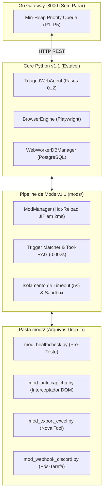

# 🧩 ARQUITETURA V1.1: SISTEMA DE MODS & PIPELINE EXTENSÍVEL

> **Projeto:** WebWorker-Platform  
> **Versão:** 1.1  
> **Objetivo:** Permitir extensão modular do sistema via arquivos únicos em `mods/`, preservando a estabilidade do Core, a latência de execução e a janela atencional do modelo SLM local (Qwen 2.5 3B).

---

## 1. Visão Geral & Motivação

Na **Versão 1.1**, a plataforma consolida uma base sólida e desacoplada:
* Microserviço Go Gateway (`:8000`) com fila Min-Heap (`P1..P5`) e `sync.Mutex`.
* Frota Python com Playwright, Telemetria Universal Ollama-First e banco relacional PostgreSQL (`WebWorker_db`).
* Suíte de testes determinísticos cobrindo invariantes e propriedades via Hypothesis.

A diretriz arquitetural para extensões aplica o **Princípio Aberto/Fechado (Open/Closed Principle)**:
> *"O código do Core (Go, Banco, Motor de Navegação e Fases de Triagem) permanece fechado para modificações arriscadas, mas 100% aberto para extensões através de Mods externos drop-in."*

---

## 2. Pilares de Engenharia do Sistema de Mods



### 2.1. Desacoplamento de Processos & Zero-Downtime
* **Go Gateway:** Fica em execução contínua no terminal/serviço. Nunca precisa ser reiniciado para carregar ou descarregar mods.
* **Python Workers:** Carregam os mods da pasta `mods/` **sob demanda (Just-in-Time)** usando `importlib.invalidate_caches()` ao receber cada tarefa. Modificações em arquivos de mods entram em vigor no próximo turno sem reiniciar processos.

---

## 3. O Dilema de Escala dos SLMs de 3B & Soluções de Otimização

### 3.1. O Problema: *Tool Choking* e Lentidão em Cascata
* **Colapso Atencional:** Se o usuário tiver 32 mods instalados e todos injetarem ferramentas no prompt da IA, o modelo de 3B receberá **40+ ferramentas no JSON Schema**. Modelos compactos perdem precisão com mais de 6 ferramentas simultâneas.
* **A Armadilha do Pré-Processamento Sequencial:** Dividir a triagem em 4 etapas cognitivas com a IA aumentaria o tempo da tarefa em 4x (adicionando 6 a 8 segundos de inferência por turno).

### 3.2. A Tríade de Solução da v1.1
1. **Mods de Código Puro (80% dos Mods):** Validações de rede (ping), preenchimento atômico de formulários, gravação em CSV e bypass de cookies rodam em **Python puro (1 a 30 milissegundos)**, sem gastar nenhum token da GPU.
2. **Trigger Matching por Evento (0.001s):** Cada mod declara quando deve ser ativado. O mod de Captcha só acorda se a tag do captcha estiver no DOM. O mod de tabela só acorda se houver `<table>`. Em uma página comum, **30 dos 32 mods permanecem dormentes**.
3. **Tool-RAG Semântico Leve (0.002s):** Algoritmo baseado em palavras-chave (BM25/TF-IDF na CPU) seleciona apenas as **Top 2 ferramentas** mais compatíveis com o objetivo do usuário. A IA de 3B recebe no máximo **5 a 6 ferramentas afiadas**.

---

## 4. Mapeamento Rigoroso dos 8 Edge Cases & Vacinas Arquiteturais

| # | Edge Case / Armadilha | Risco para o Sistema | Vacina Arquitetural na v1.1 |
| :-: | :--- | :--- | :--- |
| **01** | **Falso Positivo do Gatilho** | O mod acorda na hora errada (ex: artigo de blog citando a palavra "captcha"). | Gatilhos baseados em **seletores CSS do DOM** (`iframe[src*='recaptcha']`), nunca em texto livre. |
| **02** | **Falso Negativo do Roteador** | O mod de exportação foi filtrado no início, mas a IA precisa dele no meio da tarefa. | Meta-tool do Core: `browser_search_more_tools(category)` permite consulta sob demanda. |
| **03** | **Colisão de Nomes de Tools** | Dois mods registram funções com nomes ou parâmetros idênticos. | **Namespacing obrigatório** (`mod_<nome>__<funcao>`) e rejeição de duplicatas na carga. |
| **04** | **Conflito de Ordem de Hooks** | Mod de login tenta clicar antes do mod de cookies fechar o modal. | **Prioridades numéricas estritas:** `@hook(stage="pre_interaction", priority=10)`. |
| **05** | **Mod Mal-Escrito / Travamento** | Mod entra em loop infinito ou faz HTTP sem timeout, congelando o worker. | **Timeout assíncrono estrito:** `asyncio.wait_for(mod_fn(), timeout=5.0)` aborta o mod instável. |
| **06** | **Vazamento de Estado entre Tarefas** | Mod usa variáveis globais e expõe dados de um site na tarefa de outro usuário. | Mods estritamente **Stateless**. Dados trafegam exclusivamente via `TaskContext` efêmero. |
| **07** | **Explosão de Tokens no Schema** | Descrição de ferramenta com 500 palavras devora o contexto do modelo 3B. | **Governança de Schema:** limite rígido de 200 caracteres na descrição e máximo de 4 parâmetros. |
| **08** | **Inferno de Dependências** | Mod A exige lib X e Mod B exige lib Y conflitante. | Mods de primeiro nível utilizam **exclusivamente a stdlib do Python** e as APIs do Core. |

---

## 5. Especificação da API do Desenvolvedor de Mods (v1.1)

Um mod na versão 1.1 é um **arquivo Python único e autocontido** dentro de `mods/`:

```python
# mods/mod_auto_export_csv.py
from src.mods.mod_api import BaseMod, skill, hook, TaskContext

class CSVSkillMod(BaseMod):
    name = "csv_exporter"
    version = "1.0.0"
    priority = 50

    # Gatilho: só acorda se o usuário pedir dados tabulares ou exportação
    trigger_keywords = ["csv", "tabela", "exportar", "planilha"]

    @skill(
        name="export_extracted_to_csv",
        description="Salva uma lista de registros em um arquivo CSV local formatado.",
        parameters={
            "filename": {"type": "string", "description": "Nome do arquivo sem extensão"},
            "rows": {"type": "array", "description": "Lista de dicionários a exportar"}
        }
    )
    def export_csv(self, filename: str, rows: list, ctx: TaskContext):
        import csv
        path = ctx.get_artifact_path(f"{filename}.csv")
        # Escreve arquivo via stdlib sem bibliotecas externas
        ...
        return {"success": True, "saved_path": str(path), "total_rows": len(rows)}

    @hook.after_task
    def notificar_conclusao(self, ctx: TaskContext, result: dict):
        # Ação de pós-processamento rápida em Python puro
        pass
```

*Documento técnico de referência da arquitetura v1.1.*
